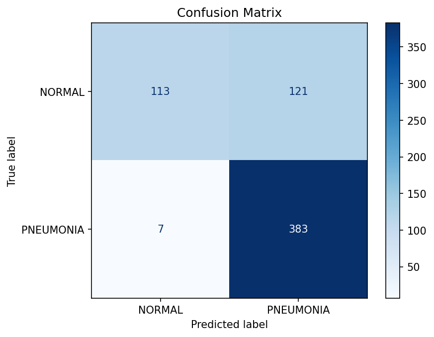

# Pneumonia Detection with a CNN

A convolutional neural network that classifies chest X-rays as normal or showing pneumonia. Built for my Introduction to Deep Learning course at Pace University (Spring 2026).

## Dataset

The [Chest X-Ray Images (Pneumonia)](https://www.kaggle.com/datasets/paultimothymooney/chest-xray-pneumonia) dataset from Kaggle, originally from the Guangzhou Women and Children's Medical Center. It comes pre-split into folders:

| Split | Images |
|---|---|
| Train | 5,216 (1,341 normal, 3,875 pneumonia) |
| Test | 624 (234 normal, 390 pneumonia) |
| Validation | 16 |

The images aren't included in this repo because of their size. Download them from the Kaggle link above.

## The Model

A CNN built with TensorFlow and Keras:

- 3 convolutional blocks (32, 64, then 128 filters), each followed by max pooling
- A dense layer with 128 neurons and 50% dropout to reduce overfitting
- A sigmoid output that predicts normal (0) or pneumonia (1)

Images were resized to 64x64 and pixel values scaled from 0-255 down to 0-1. The model trained for 10 epochs with the Adam optimizer.

## Results

**Test accuracy: 79.49%** (training accuracy: 98.62%)

| | Predicted Normal | Predicted Pneumonia |
|---|---|---|
| **Actually Normal** | 113 | 121 |
| **Actually Pneumonia** | 7 | 383 |

The model caught **383 of 390 pneumonia cases (98% recall)** and only missed 7. In medical screening, missing a sick patient is the worst mistake, so this is the most important number.

The weakness is normal X-rays. The model only got 113 of 234 right and flagged the rest as pneumonia. The gap between training and test accuracy also shows some overfitting.

## Catching an Evaluation Bug

My first confusion matrix didn't add up. The correct predictions it showed worked out to 62% accuracy, but Keras reported 73%. I traced it to the test images being shuffled when they loaded, so each prediction was being compared to the wrong image's label. Setting `shuffle=False` on the test set fixed it, and the confusion matrix now matches the test accuracy exactly.

## Testing the Class Imbalance

The training set has almost 3 times as many pneumonia images as normal ones, so my first guess was that this imbalance made the model over-predict pneumonia. To test it, I undersampled the pneumonia class down to 1,341 images to match the normal class, then trained a fresh model with the same architecture.

| | Full Dataset | Undersampled |
|---|---|---|
| Test accuracy | 79.49% | 79.97% |
| Normal correct | 113 / 234 | 120 / 234 |
| Pneumonia missed | 7 | 11 |

The results were almost the same. Even with perfectly balanced classes, the model still flagged about half of the normal X-rays as pneumonia, so the imbalance wasn't the main cause. My best guess is the 64x64 image size, which throws away fine detail that separates healthy lungs from sick ones. I kept the full dataset for the final model since it missed fewer pneumonia cases.

## What I Learned

- **Check that your numbers agree with each other.** The bug only showed up because the confusion matrix and the accuracy score told different stories.
- **Test your assumptions.** I was sure the class imbalance was the problem, but balancing the data barely changed anything.
- **Accuracy alone hides a lot.** 79% sounds okay, but the confusion matrix shows the model is great at one class and weak at the other.

## Next Steps

- Increase the image size to 128x128 to keep more detail in the X-rays
- Try data augmentation (flipped, rotated, or zoomed copies) to give the model more varied examples
- Use class weights so mistakes on normal images count more during training
- Add early stopping to prevent overfitting
- Train each version several times and average the results, so small differences can be trusted

## How to Run

1. Download the dataset from Kaggle and unzip it
2. In the notebook, change `base_dir` to the path of your `chest_xray` folder
3. Install the libraries: `pip install tensorflow numpy pandas matplotlib scikit-learn`
4. Open `project2.ipynb` in Jupyter or VS Code and run all cells

Results may shift slightly each time you retrain.

## Tools

Python, TensorFlow, Keras, pandas, NumPy, scikit-learn, Matplotlib, Jupyter
